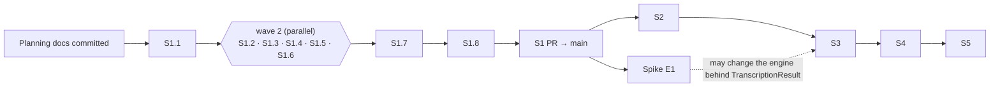

# Implementation roadmap: SubSync v1

Last updated: 2026-10-18 · Skill: `product-engineering:planning-implementation`

- **Spec and technical context:**
  - Product and design, all agreed on 2026-09-25: [product brief](../../product-design/subsync-v1/product-brief.md) (R1–R26, P1–P8, N1), [UX flows](../../product-design/subsync-v1/ux-flows.md) (F1–F25, W1–W2, U1–U7) and [handoff](../../product-design/subsync-v1/handoff.md) (slices S1–S5 and the spike, E1–E12).
  - Technical baseline, revised 2026-09-25: [phase-3 plan](../../../spec/plan/phase-3-netflix-compliance.md), [phase-4 plan](../../../spec/plan/phase-4-cli-output.md), [phase-2 plan](../../../spec/plan/phase-2-core-pipeline.md) (P4–P7 recorded), and `spec/context/*` (data models, Netflix, YouTube, dependencies).
  - Work packages: [S1 tasks](../../../spec/tasks/slice-1-local-file-srt.tasks.md). Later slices get their own `spec/tasks/slice-N-*.tasks.md` once the previous slice merges.
- **Agreed architecture and decisions:** E2, E4, E7, E8 and E9 were settled while planning S1. See [Engineering decisions](#engineering-decisions) below.
- **Current baseline:**
  - `main` @ `2940f27`. Phases 1–2 are merged, 87 tests pass and ruff is clean.
  - `cli.py` still prints "Hello World".
  - Environment: FFmpeg 9.0.1 on the Mac (M1 Max, 32 GB); no Whisper model cached yet.
  - Importing Whisper takes 1.0–1.9 s.
- **Integration owner:** the session that owns the slice branch (one per slice). Igor approves each slice PR to `main`.

## Packages

Status legend: *proposed* = planned, not dispatchable · *ready* = prerequisites met, awaiting go-ahead · *active* · *implemented* · *verified* · *reviewed* · *merged*. Each status names its evidence.

| Package | Useful outcome / requirements | Plan | Prerequisites | Ownership / permitted parallelism | Status / evidence |
|---|---|---|---|---|---|
| **S1.1** Contracts and test scaffolding | Error categories with hints and exit codes, `MediaSource`, `ComplianceFlag`, SRT invariant checker, `e2e` marker | [S1 → S1.1](../../../spec/tasks/slice-1-local-file-srt.tasks.md#task-s11-contracts-and-test-scaffolding) | Plan approved; planning docs committed | `errors.py`, `models.py`, `pyproject.toml` (pytest), `Taskfile.yml`, test helpers. Runs alone (wave 1) | **merged** into `feat/s1-local-file-srt` @ `a849d43` (2026-09-26): 180 tests pass, ruff clean; quick review Q1–Q2 (checker test strength) fixed and rechecked |
| **S1.2** Subtitle processor (core) | R8, R9, R10 (punctuation and balance), R12, P2 | [S1 → S1.2](../../../spec/tasks/slice-1-local-file-srt.tasks.md#task-s12-subtitle-processor-core) | S1.1 | `processor.py` + tests. Parallel with S1.3–S1.6 (wave 2) | **merged** into `feat/s1-local-file-srt` (2026-09-26, `42ae264`): 47 tests incl. a 200-case seeded adversarial test; quick review fuzzed ~940,000 subtitles with 0 invariant violations; S1.2-Q1 fixed |
| **S1.3** SRT writer and output planner | R14 (file), R15 + U1, R16 (srt), R17; F4, F11, F12, F23 | [S1 → S1.3](../../../spec/tasks/slice-1-local-file-srt.tasks.md#task-s13-srt-writer-and-output-planner) | S1.1 | `output.py`, `writer.py` + tests. Wave 2 | **merged** (2026-09-26, `5463975`): 43 tests; quick review found and closed 2 blocking (no-clobber publish on exFAT/FAT32, temp-file cleanup) and 6 other findings, rechecked on real exFAT/FAT32 images |
| **S1.4** Local media via FFmpeg | R1, R4, R24 (FFmpeg); F6, F9; cancellation of the FFmpeg child | [S1 → S1.4](../../../spec/tasks/slice-1-local-file-srt.tasks.md#task-s14-local-media-via-ffmpeg) | S1.1 | `media.py`, `tests/media_fixtures.py` + tests. Wave 2 | **merged** (2026-09-26, `2e38a9a`): 32 tests on real FFmpeg; Ctrl+C leaves no FFmpeg child (worst case 0.72 s over 250 signals); 8 review findings closed, incl. duration-less WebM/MKV |
| **S1.5** Transcriber stages | R7 notice; F19, F20, F21; quiet Whisper | [S1 → S1.5](../../../spec/tasks/slice-1-local-file-srt.tasks.md#task-s15-transcriber--separate-model-loading-clear-errors-quiet-output) | S1.1 | `transcriber.py` + tests. Wave 2 | **merged** (2026-09-26, `289e449`): 42 tests; 9 review findings closed (partial-download and cached-OSError classification, quiet-output test strength, F19–F21 wording) |
| **S1.6** CLI shell | R3 (file), R6, R7 (validation), R20, R22 mapping; F1–F3, F7, F8, F24, F25; fast startup | [S1 → S1.6](../../../spec/tasks/slice-1-local-file-srt.tasks.md#task-s16-cli-shell--arguments-catalog-input-resolution-errors-exit-codes) | S1.1 | `cli.py`, `catalog.py`, `sources.py` + tests. Wave 2 | **merged** (2026-09-26, `8c1556b`, follow-ups `74335b2`, `a4f4d29`): 38 CLI tests incl. a subprocess fast-startup proof; S1.6-Q1 (blocking, -v traceback) and 9 other findings closed |
| **S1.7** `generate()` and integration | The S1 user journey end to end: R5, R18 (plain), R19 (path, count, flags), R23, F22; the e2e suite | [S1 → S1.7](../../../spec/tasks/slice-1-local-file-srt.tasks.md#task-s17-generate--orchestration-stage-lines-summary-cancellation-integration) | S1.2–S1.6 | `pipeline.py` (adds `generate`), `cli.py` (seam), integration and e2e tests, `AGENTS.md`. Runs alone (wave 3) | **verified** on `feat/s1-local-file-srt` (2026-09-26, `af1603e`): combined five-lens review approved at `aaebb71` after 3 rounds ([review](review/S1.md)); fresh-context verification 12/12 pass on `8a0176b` plus a delta check on `af1603e` ([verification](verification/S1.md)); 453 default tests and E1–E4 pass |
| **S1.8** Acceptance on real episodes | A3 Studio upload, N1 baseline, E8 latency, R4 with Wi-Fi off; fixtures for S2 and S3 | [S1 → S1.8](../../../spec/tasks/slice-1-local-file-srt.tasks.md#task-s18-acceptance-on-real-episodes) | S1.7 | Igor, helped by an agent. Wave 4, before the S1 PR merges | **verified** on `864ed3a` (2026-10-18, [S1.8 run](verification/S1.md#s18-acceptance-run)): Igor reports all steps passed, Studio upload accepted (A3); the agent re-ran the rest on the same 7:20 episode: exit 0 with 111 subtitles, offline identical (R4), exit 5 in 0.13 s, Ctrl+C exit 130 in 0.24–0.32 s (E8), 0 SRT violations. N1: 7:20 in 2:20–3:15, a 14:40 input in 6:00 (≤ 15 min met, 5 min target missed on CPU). S2 fixture: `~/dev/subsync-test/bad-commit-messages.transcript.json` |
| **Spike E1** Transcription engine | N1: is a 15-minute episode ≤ 15 min (target ≤ 5)? Compares openai-whisper (CPU), mlx-whisper, faster-whisper and whisper.cpp on word timestamps, `initial_prompt`, language detection and Ctrl+C latency | To write after S1.8 | S1 merged, S1.8 timing | Scratch scripts only, no `src/` changes, so it can run alongside S2. Outcome: a recommendation, and an ADR if the engine changes | proposed |
| **S2** Readable and reviewable | R10 (article/preposition), R11, R13, P1; R18 spinner, elapsed time, model download %; R19 full compliance block | To write after S1 merges | S1 merged; transcript fixture from S1.8 | Processor (`processor.py`) and CLI display (`cli.py`). Decide E3 and E5 when planning | proposed |
| **S3** Tech vocabulary | R25 (`--prompt`, `--glossary`), W1, F5 | To write after S2 | S2 merged (shares `transcriber.py` decoding options, E5); S1.8 jargon baseline | `transcriber.py`, `cli.py`. Could run beside S4 if both are planned together; Igor chose S3 first | proposed |
| **S4** YouTube URL input | R2, R3 (URL), R14 (title name), F10, F13–F18, download %, exit 3, P4, P7; retire `process_video()` | To write after S3 | S1 merged (for `generate`); decide E6, E11, E12 | `url_handler.py`, `audio_extractor.py`, `pipeline.py`, `sources.py`, `output.py` (sanitizing) | proposed |
| **S5** VTT and finish | R16 (vtt), F4 inference, R18 (non-terminal, `NO_COLOR`), README usage and install (E12), `--help`, CHANGELOG, CI decision | To write after S4 | S4 merged | `writer.py`, `output.py`, `cli.py`, README, CHANGELOG | proposed |

## Schedule

- **Order:** S1 → S2 → S3 → S4 → S5 (agreed at milestone 3). The spike starts once S1 is merged and runs alongside S2. Swapping the engine is a separate, user-approved package that goes before or inside S3. That's because `initial_prompt` support (R25) depends on the engine.
- **Branches:**
  - One slice branch per slice (`feat/s1-local-file-srt`), cut from `main` after the planning commit.
  - Wave-2 packages each run in their own git worktree, branched from the slice branch after S1.1 lands. The integration owner merges them back.
  - Each slice goes to `main` as one PR, as with PR #3.
- **Commits:** SubSync's global rule says no commits without Igor's say-so. Dispatching implementation therefore needs Igor to authorize commits for that slice's branches.

## Engineering decisions

Settled 2026-09-25 during S1 planning. Details are in the [phase-4 plan](../../../spec/plan/phase-4-cli-output.md#architecture-decisions).

| ID | Decision | Who | Revisit when |
|---|---|---|---|
| E2 | Local audio: ffprobe for duration and the no-audio/unreadable checks (F9); FFmpeg extracts the default audio stream to 16 kHz mono WAV. No track selection | Planning default (routine) | A multi-track recording picks the wrong stream |
| E4 | One `generate()` orchestrator and a `MediaSource` model. `SubtitleFile` drops `video_id`. S4 retires `process_video()` | **Igor** | — |
| E7 | Layers: unit, integration with real FFmpeg and a stand-in transcriber, the SRT invariant checker, and opt-in e2e (`pytest -m e2e`) on a clip made with macOS `say` and FFmpeg, using Whisper `tiny`. Manual named cases. **No CI until S5** | **Igor** | S5 |
| E8 | In-process transcription. Ctrl+C unwinds all stages and exits 130 within 2 s | Planning default | S1.8 measures more than 2 s → move transcription to a child process |
| E9 | UTF-8 without BOM, LF, one blank line between cues, single trailing newline. CPS counts spaces and punctuation, not line breaks | Planning default | A3 upload fails |
| — | Fast startup: no Whisper, torch or yt-dlp import in stages 0–1. Static model and language lists with a drift test | Planning finding (Whisper import takes 1–2 s) | — |
| — | Until S4, a YouTube URL input exits 2 and suggests the local-file route | Planning default | S4 |

**Still open, by slice:** E1 (spike); E3 and E5 (S2 planning, which also settles how repeated lines are compared for R13); E5 hint length (S3); E6, E11 and E12 (S4; E12 carries over to S5); E10 after v1.

## Integration and completion

- **Shared contracts and files:**
  - `errors.py`, `models.py`, `pyproject.toml`, `Taskfile.yml` and the test helpers belong to S1.1 only. Wave-2 packages must escalate rather than edit them.
  - `cli.py` is written by S1.6, then extended by S1.7, one after the other.
  - `tests/media_fixtures.py` (S1.4) and `tests/srt_invariants.py` (S1.1) are shared read-only by later packages.
  - `AGENTS.md` is updated by S1.7 only.
- **Integration order and combined journeys:**
  - Merge S1.1, then wave 2 in any order (their files don't overlap), then S1.7.
  - Combined journeys:
    - The success run (I1, E1).
    - Fail-fast re-run (I3, E3).
    - Cancel (I11, E4).
    - Offline (E2).
    - Missing FFmpeg (I13).
- **Reviews:**
  - Each package is reviewed on its own branch (`product-engineering:reviewing-code-changes`, quick mode) before it merges into the slice branch.
  - After S1.7, a combined review of the whole slice diff checks for omissions and interactions between packages.
  - Any later edit invalidates the evidence it touches.
- **Verification:**
  - `product-engineering:verifying-implementation` drives the CLI through every S1 acceptance criterion on the slice head.
  - The report goes in the S1 PR body, or in `docs/product-engineering/subsync-v1/verification/S1.md` if there is no PR.
- **Required final checks:**
  - `task test`, `task test:e2e` and `task lint` pass on the slice head, on Igor's Mac (macOS, FFmpeg on PATH, `say` available).
  - S1.8 evidence is recorded in the S1 row above.
- **Open decisions and blockers:**
  - None block S1.1.
  - Dispatch needs:
    1. Igor's approval of this plan.
    2. Committing the planning docs, which gives the baseline revision.
    3. Authorization to commit on the S1 branches.
- **Next dispatchable work:** the S1 PR from `feat/s1-local-file-srt` to `main`, for Igor's approval. After it merges: S2 planning and the E1 spike, neither planned yet.
