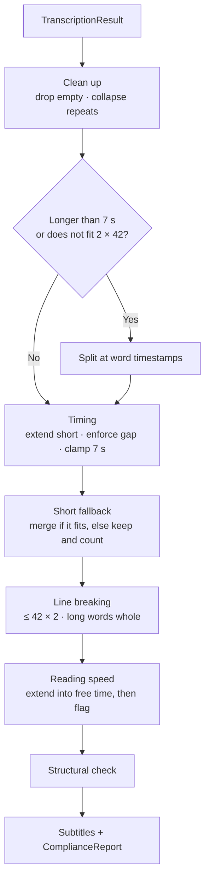

# Phase 3: Netflix Compliance Processing

## Overview

This phase implements the subtitle processor that transforms raw transcription segments into subtitle events that follow the Netflix timing, layout and reading-speed rules. It handles cleanup, splitting, timing adjustments, line breaking, reading-speed easing and compliance reporting.

**Revised 2026-09-25** for SubSync v1 from the agreed [product brief](../../docs/product-design/subsync-v1/product-brief.md) (R8–R13, P1, P2) and [handoff](../../docs/product-design/subsync-v1/handoff.md). The phase is no longer built as one block: slice **S1** delivers the core processor and slice **S2** the readability rules. See [Delivery by slice](#delivery-by-slice) and the [implementation roadmap](../../docs/product-engineering/subsync-v1/implementation-roadmap.md).

**Dependencies**: Phase 2 complete (merged)

---

## Goals

1. Turn a `TranscriptionResult` into ordered subtitle events that never overlap, keep an 83 ms gap and last 833 ms–7 s where the audio allows
2. Lay text out in at most 2 lines of at most 42 characters, splitting longer speech at word timestamps
3. Keep every transcribed character: text is never shortened or rewritten (long words, reading speed)
4. Ease reading speed by timing only, then flag what is still too fast
5. Produce a compliance report that separates structural errors (bugs) from reviewable warnings, with the timestamp of every flagged subtitle

---

## Scope for v1

| In scope | Out of scope (v1) |
|---|---|
| English line-break word lists (videos are English, A5) | Line-break rules for other languages (E10, after v1) |
| Adult reading speed: 20 CPS | Children's profile (17 CPS, `--children`). The `ProcessingConfig` fields may stay but nothing uses them |
| Basic line breaks: punctuation, balance, and never ending line 1 on an English article or preposition | Full grammar rules: names, adjective–noun pairs, auxiliary verbs (later) |
| Timing-only reading-speed easing | Rewriting or condensing text |
| Cleanup of empty segments and back-to-back repeats | Fix-up maps for mis-hearings (R26, later) |

---

## Architecture

### Processing Flow



### Component Responsibilities

| Component | Input | Output | Responsibility |
|-----------|-------|--------|----------------|
| Cleanup | Segments | Segments | Drop empty segments; collapse back-to-back identical lines (R13) |
| Timing Processor | Chunks | Timed chunks | Split over-long speech, enforce duration limits and gaps (R8, P1) |
| Text Segmenter | Text | Lines (1–2) | Apply line-break rules; keep long words whole (R9, R10, R12) |
| Reading-Speed Easer | Subtitles | Subtitles + flags | Extend into free time, then flag (R11) |
| Subtitle Processor | TranscriptionResult | Subtitles + Report | Orchestrate the above and build the compliance report (P2) |

How these are split into functions or modules is an implementation choice; only the Subtitle Processor's interface is a contract.

---

## Architecture Decisions

### Transform, Don't Mutate

**Decision**: Processing creates new subtitle objects rather than modifying transcription segments.

**Rationale**:
- Clear separation between raw data and processed output
- Easier to debug and test
- Can compare before/after if needed

### Line Breaking Strategy

**Decision**: Rule-based breaking with linguistic heuristics. Word lists (articles, prepositions, conjunctions) apply to **English only** in v1.

**Rationale**:
- Predictable, testable behavior
- No ML dependency for text processing
- Other languages need their own lists; they come after v1 (E10)

**Alternative Considered**: NLP-based sentence parsing
- Rejected: Overkill for subtitle line breaks, adds unnecessary dependency

### Text Is Never Changed

**Decision**: The processor never shortens, truncates or rewrites transcribed words. A word longer than 42 characters (URL, package name, CLI flag) goes on its own line unchanged and is flagged as a warning (R12).

**Rationale**:
- Tech content is full of long tokens that must stay copy-pasteable (`github.com/ikcode-dev/subsync/blob/main/README.md`)
- A flagged, correct subtitle is better than a compliant, wrong one

**Supersedes**: the earlier rule "Single word > 42 chars → truncate with ellipsis".

### Reading Speed: Extend, Then Warn

**Decision**: When a subtitle exceeds 20 CPS, extend its end into the free time that follows, staying within 7 s and keeping the 83 ms gap to the next subtitle. Only if it is still too fast is it flagged. The text is never changed and processing never stops for CPS (R11).

**Rationale**:
- A timing-only fix is consistent with "text is never changed"
- Speech in screencasts often pauses; the free time is usually there
- What remains is listed with timestamps for review in the Studio editor

### Short Subtitles: Merge Only as a Fallback

**Decision**: A subtitle shorter than 833 ms is first extended into free time. If the next subtitle is too close, merge it with a neighbor only when the result still fits 2 × 42 characters and 7 s. Otherwise keep it and count it in the report (P1).

**Rationale**: Stops one-word flashes without inventing timing.

**Supersedes**: "Consider merging if combined < 7s".

### Errors vs Warnings (P2)

**Decision**: The report's `errors` cover only structural breakage: an overlap, an out-of-order subtitle, an end at or before its start, or more than 2 lines. The processor must make these impossible, so an error means a bug. Every other finding is a warning. `is_compliant` is true exactly when there are no errors. Zero subtitles is not a report error: the caller treats it as "no speech found" (exit 4, nothing written).

**Rationale**: The exit code answers one question — did I get a file I can upload? — so warnings never fail the run.

### Millisecond Precision

**Decision**: Subtitle start and end times are whole milliseconds.

**Rationale**: The invariants (≥ 83 ms gap, ≤ 7000 ms, no overlap) must still hold after the times are written as `HH:MM:SS,mmm`. Rounding at write time could otherwise turn an 83.0 ms gap into 82 ms.

### Characters per Second

**Decision**: CPS counts every displayed character, including spaces and punctuation, and excludes line breaks: `CPS = sum of line lengths / duration in seconds` (E9). This is the existing `Subtitle.char_count` definition.

---

## Components

### 1. Cleanup (R13)

- Drop segments whose text is empty or whitespace only
- Collapse back-to-back identical lines (Whisper's repeat loops over music or silence). Four consecutive "Thank you." become one at most
- How lines are compared (exact text, or ignoring case and punctuation) and the Whisper decoding options that reduce repeats (E5) are settled in S2 planning

### 2. Timing Processor (R8, P1)

**Timing Rules**:

```
Split: any chunk longer than 7000 ms, or whose text cannot be laid out
       in 2 lines of 42 characters, is split at word timestamps,
       preferring sentence/clause boundaries (after . , ! ? :)
       Without word timestamps: interpolate word times from the
       segment's time span in proportion to character count

Start/end: taken from the first and last word of the chunk

Short (< 833 ms): extend the end into free time,
       up to (next start − 83 ms) and at most 7000 ms total
       still short → merge fallback (P1), else keep and count

Gap/overlap: if (next start − this end) < 83 ms,
       end this subtitle at (next start − 83 ms)
       the result must keep end > start; if it cannot,
       resolve by moving or merging, never by overlapping

Long single word: a word whose own timing exceeds 7000 ms is clamped
```

**Context**: [netflix-compliance.md](../context/netflix-compliance.md)

### 3. Text Segmenter (R9, R10, R12)

- Text of up to 42 characters stays on one line
- Otherwise split into 2 lines of at most 42 characters each

**Line Break Priority** (English, v1):

1. **After punctuation** (. , ! ? : ;) — best breaks
2. **Balanced lines** — among valid breaks prefer the one with the most similar line lengths
3. **Never end line 1 on an article or preposition** ("the / package" ❌) — S2

**Long words**: a word over 42 characters gets its own line, unchanged, and a `long_word` flag with the subtitle's timestamp (the summary labels it "long word").

**Later** (not v1): names, adjective–noun pairs, verb–auxiliary pairs, other languages.

### 4. Reading-Speed Easer (R11)

- Calculate CPS per subtitle
- Above 20 CPS: extend the end into free time (≤ 7 s total, keep the 83 ms gap)
- Still above: flag with the timestamp and the CPS value
- Report both counts: above the limit, and how many were eased by extending

### 5. Subtitle Processor

**Responsibilities**:
- Orchestrate cleanup → split → timing → short fallback → lines → reading speed → structural check
- Number subtitles from 1 in time order
- Build the compliance report: counts, flagged subtitles with timestamps, warnings, errors

---

## Interface Definitions

### Subtitle Processor

**process_transcription**:
- Input: TranscriptionResult, ProcessingConfig
- Output: (ordered list of Subtitle, ComplianceReport)
- Never raises for content problems; an empty result yields zero subtitles

### ComplianceReport (additions for v1)

The existing report (counts, `is_compliant`, `warnings`, `errors`) gains a list of **flags**. Each flag names:

| Field | Meaning |
|---|---|
| kind | `short` (under 833 ms, could not be fixed), `long_word` (R12; shown as "long word"), `cps` (R11, from S2) |
| subtitle index | The flagged subtitle's number |
| start time | For the summary's `HH:MM:SS` jump list |
| detail | e.g. the CPS value |

Counts needed by the summary (S2): subtitles adjusted automatically, left short, over line length, above CPS, eased by extending. See [data-models.md](../context/data-models.md).

---

## Error Handling

| Condition | Behavior |
|-----------|----------|
| Empty segment text | Skip segment |
| Single word > 42 chars | Keep whole on its own line; `long_word` flag with timestamp (R12) |
| Overlapping timestamps from Whisper | Adjust to enforce order, no overlap and the 83 ms gap |
| No word timestamps | Interpolate word times across the segment for splits |
| Zero-length or reversed word times | Repair so every subtitle has end > start |
| All caps text | Preserve (don't modify case) |
| Transcript with no speech | Zero subtitles; the caller reports "no speech found" (P2) |

---

## Edge Cases

| Case | Expected Behavior |
|------|-------------------|
| Empty segment | Skip, don't create subtitle |
| Single very long word | Unchanged, own line, warned in report |
| Overlapping timestamps from Whisper | Adjust to enforce gaps |
| Consecutive very short segments | Merge fallback only when the result fits 2 × 42 and 7 s (P1) |
| Repeated line over music ("Thank you." × 4) | Collapsed to one at most (R13, S2) |
| Special characters/Unicode | Preserve, handle in output encoding |
| 150-character sentence | 2+ subtitles, each ≤ 2 × 42, times from word timestamps |

---

## Risks & Mitigations

| Risk | Impact | Mitigation |
|------|--------|------------|
| Aggressive splitting | Choppy subtitles | Use word timestamps; prefer clause boundaries |
| Poor line breaks | Awkward reading | Punctuation and balance first (S1), article/preposition rule (S2) |
| CPS always exceeded | User annoyance | Ease by timing, then warn; never block |
| Rounding breaks invariants | Invalid gaps in the file | Whole-millisecond times; invariant checker runs on the written SRT |
| Whisper timestamp glitches | Overlaps, zero-length words | Repair rules above; adversarial fixtures in tests |

---

## Delivery by slice

| Slice | Delivers |
|---|---|
| **S1** | Empty-segment skip; split at word timestamps (> 7 s or not fitting 2 × 42); timing (extend short, gap, no overlap, 7 s clamp, keep-and-count short); lines (punctuation and balance); long words kept whole (R12); P2 structural check; flags with timestamps; whole-millisecond times |
| **S2** | Repeat-line cleanup (R13) with E5 decoding defaults; English article/preposition rule (R10); reading-speed easing and flags (R11); short merge fallback (P1); the counts for the full compliance block |

---

## Acceptance Criteria

- [ ] Short subtitles (< 833 ms) are extended into free time; those that cannot be fixed are counted
- [ ] Long speech (> 7000 ms or > 2 × 42 characters) is split at word timestamps
- [ ] Minimum 83 ms gap, no overlaps, strictly ordered subtitles
- [ ] Lines respect the 42-character limit, except a single word longer than 42, which is kept whole and flagged
- [ ] Maximum 2 lines per subtitle
- [ ] Line breaks prefer punctuation and balance, and never end line 1 on an English article or preposition
- [ ] CPS calculated with spaces and punctuation, without line breaks
- [ ] High-CPS subtitles are eased by extending, and flagged only if still too fast (not blocked)
- [ ] Back-to-back repeated lines are collapsed
- [ ] Compliance report separates structural errors from warnings (P2) and lists flagged subtitles with timestamps
- [ ] All unit tests pass, including an invariant check on the written SRT

---

## Dependencies

- [netflix-compliance.md](../context/netflix-compliance.md) - Timing and formatting rules
- [data-models.md](../context/data-models.md) - Subtitle, ComplianceReport models
- [product-brief.md](../../docs/product-design/subsync-v1/product-brief.md) - R8–R13, P1, P2

---

## Next Phase

[Phase 4: CLI & Output](./phase-4-cli-output.md) implements the writer and CLI. Both phases are delivered together, slice by slice.
