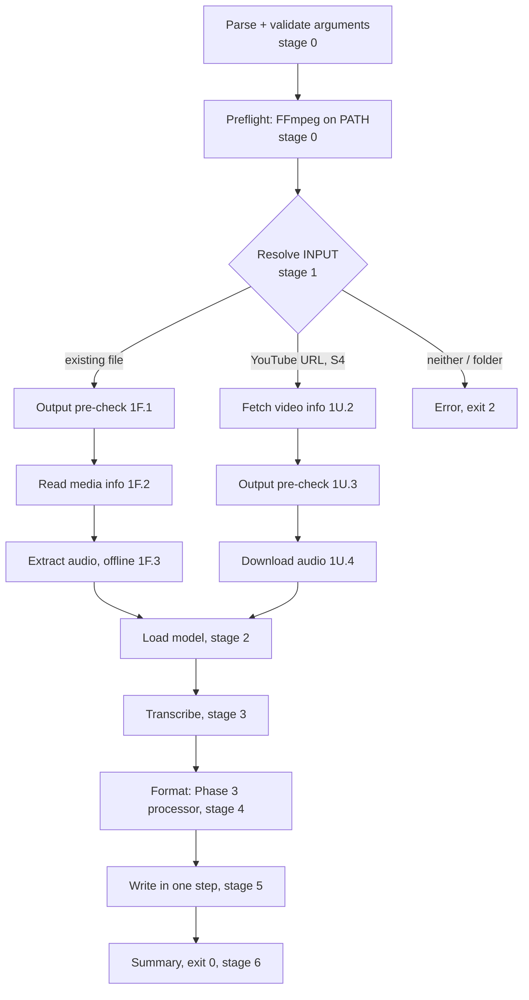

# Phase 4: CLI & Output Generation

## Overview

This phase completes the application: input resolution for local files and YouTube URLs, the subtitle writer, the `subsync generate` command, progress display, the summary, and actionable errors. This is where everything comes together into a usable tool.

**Revised 2026-09-25** for SubSync v1 from the agreed [product brief](../../docs/product-design/subsync-v1/product-brief.md), [UX flows](../../docs/product-design/subsync-v1/ux-flows.md) and [handoff](../../docs/product-design/subsync-v1/handoff.md). The UX flows are the source of truth for wording, transcripts and the failure table (F1–F25, W1–W2). The phase is delivered in slices S1–S5 together with Phase 3; see [Delivery by slice](#delivery-by-slice) and the [implementation roadmap](../../docs/product-engineering/subsync-v1/implementation-roadmap.md).

**Dependencies**: Phase 2 complete (merged); Phase 3 delivered alongside

---

## Goals

1. `subsync generate <input>` turns a local media file or a YouTube URL into an uploadable subtitle file
2. SRT output (VTT optional), UTF-8 without BOM, written in one step
3. Fail fast: validate arguments, FFmpeg and the output location before any heavy work
4. Progress for every stage, a summary that says where the file is and what to review, and errors that say what to do next
5. Exit codes that answer "did I get a file I can upload?"

---

## Architecture

### Flow



### Component Responsibilities

| Component | Input | Output | Responsibility |
|-----------|-------|--------|----------------|
| Model and language catalog | — | Valid names | Validate `-m` and `-l` without importing the ML stack |
| Input Resolver | INPUT string | MediaSource or error | File vs URL vs neither (R3) |
| Local Media | File path | Duration; 16 kHz mono WAV | FFmpeg preflight, media probe, offline extraction (R1, R4, R24) |
| Output Planner | Source, `-o`, `-f`, language, `--force` | Output path(s) | Naming, `-o` rule, fail-fast pre-check (R14, R15, R16) |
| Subtitle Writer | Subtitles, format, path | File | SRT/VTT serialization, one-step write (R16, R17) |
| Orchestrator (`generate`) | Resolved request | Result or error | Run stages 1–5 for either source kind, report stage events, clean up |
| CLI | argv | Exit code | Arguments, stage lines, summary, error blocks, exit codes (R18–R24) |

---

## Architecture Decisions

### CLI Framework

**Decision**: Use `argparse` (stdlib) with `rich` for output.

**Rationale**:
- No additional CLI framework dependency
- `argparse` is sufficient; subcommands leave room for `translate`
- `rich` provides spinners and formatted output
- Can migrate to `typer` or `click` later if needed

### One Orchestrator for Files and URLs (E4)

**Decision**: A single source-agnostic orchestrator, `generate`, runs every stage after input resolution. A new **MediaSource** model describes what is being processed for both routes: kind (file or YouTube), display name, output stem, default output folder, duration, and the YouTube-only fields (video ID, channel) when they apply. `SubtitleFile` drops its YouTube-only `video_id`. S1 builds the file branch. S4 folds the URL steps of the Phase 2 `process_video()` into `generate` and retires `process_video()`.

**Rationale**:
- One place for stage order, cleanup, cancellation and progress
- Local files have no video ID, uploader or upload date; forcing them into `VideoMetadata` would muddle naming
- Reuses the Phase 2 pieces (`pipeline_temp_dir`, `transcribe_audio`'s audio-path input, `ProgressMapper`)

**Alternatives rejected**: parallel `process_file()`/`process_video()` entry points (two orchestrators to keep in sync); reusing `VideoMetadata` for files (fake IDs).

### Local Audio via FFmpeg (E2)

**Decision**: For a local file, read media info with `ffprobe` (duration, whether an audio stream exists, whether the file decodes), then extract FFmpeg's default audio stream to a 16 kHz mono WAV in the run's temporary folder. The transcriber receives the same kind of WAV from both routes. Multi-track files use FFmpeg's default stream selection; choosing a track is out of scope.

**Rationale**:
- No-audio and unreadable files fail at stage 1 (F9), before the model loads
- A visible "Extracted audio" stage, and an FFmpeg child process that can be stopped on Ctrl+C
- Whisper's own decoding also runs FFmpeg, so nothing is saved by skipping the step

### Output File Naming (R14)

| Input | Default name |
|---|---|
| Local file | `<input folder>/<stem>.<lang>.<ext>` |
| YouTube URL | `./<sanitized title>.<lang>.<ext>` |

- `-o <existing folder>` or `-o <path ending in />` → default name inside it
- `-o <anything else>` → exactly that path
- The parent folder must exist; folders are never created (F12, exit 5)
- The format comes from `-f`; if `-o` ends in `.srt`/`.vtt` and names the other format → exit 2 (F4). From S5, a `.vtt`/`.srt` extension on `-o` also sets the format when `-f` is absent

**Rationale**: the language suffix leaves room for translated tracks; file-based names put the subtitles next to the video.

### Fail Fast on Existing Output (R15, U1)

**Decision**: Before any extraction, download or transcription:
- Language set with `-l`, or `-o <file>` given → refuse if that exact path exists
- Language auto-detected → refuse if **any** `<stem>.*.<ext>` already exists in the output folder (almost certainly an earlier run)
- At write time, re-check the exact final name; the write never replaces a file without `--force`
- `--force` skips both checks

**Rationale**: a second run fails in about a second instead of after a full transcription, and hand-corrected files are protected.

### One-Step Write (R17)

**Decision**: Write the complete file to a temporary file in the target folder, then publish it under its final name in one step: without `--force` the publish must fail if the name exists; with `--force` it replaces the file. On any failure or cancellation the temporary file is removed, so no partial output ever exists.

**Supersedes**: "Check disk space before writing". A full disk now fails the write cleanly (F23, exit 5).

### SRT Serialization (E9)

- UTF-8 without BOM; LF line endings
- Cues numbered from 1; `HH:MM:SS,mmm --> HH:MM:SS,mmm`; 1–2 text lines; one blank line between cues; the file ends with a single newline
- YouTube Studio acceptance is checked by hand once (A3)

### Exit Codes (R22)

| Code | Meaning | Failure rows |
|------|---------|---|
| 0 | A subtitle file was written (warnings and even structural errors only change the headline, P2) | success, W2 |
| 1 | Environment or unexpected problem | F6, F25 |
| 2 | Bad input or usage | F1–F5, F7–F10 |
| 3 | Source unavailable (YouTube) | F13–F18 |
| 4 | Transcription produced nothing usable | F19–F22 |
| 5 | Output problem | F11, F12, F23 |
| 130 | Cancelled with Ctrl+C | F24 |

**Supersedes**: Ctrl+C = 1.

### Error Categories

Each failure is raised as a SubSync error whose message is the F-row headline and whose optional hint is the "what to do next" line. The CLI maps the error category to the exit code and renders the ✗ block. Anything that is not a SubSync error becomes F25 (exit 1). Categories: input (2), dependency (1), source unavailable (3), transcription incl. model download, out of memory and no speech (4), output incl. already exists (5). See [data-models.md](../context/data-models.md#error-categories).

### Fast Startup

**Decision**: Stages 0 and 1 (arguments, FFmpeg check, input resolution, output pre-check) must not import the ML stack. Whisper's model names and language codes are kept as static lists in SubSync, with a test that fails if they drift from the installed Whisper.

**Rationale**: importing Whisper (and torch) takes 1–2 s on Igor's Mac, which alone would break the "< 1 s" preflight (R24) and fail-fast (R15) promises.

### Cancellation (R23, E8)

**Decision**: Transcription runs in-process. Ctrl+C raises an interrupt that unwinds every stage: the FFmpeg child is stopped, the temporary folder and any temporary output file are removed, the CLI prints `Cancelled. Nothing written.` and exits 130. "Promptly" means **within 2 s** at every stage.

**Rationale**: Whisper returns to Python between model layers and decoding steps, so an interrupt is normally seen within milliseconds; a worker process adds complexity for no measured benefit. If the S1 acceptance run measures more than 2 s during transcription, move transcription into a child process (re-plan).

### Streams (U6)

Progress, warnings and errors go to stderr; the summary goes to stdout, so redirecting stdout captures a clean summary.

---

## Components

### 1. Subtitle Writer

**Responsibilities**:
- Generate SRT format output (S1) and VTT format output (S5)
- UTF-8 without BOM, LF, one-step write
- Never leave a partial file

**SRT Format**:
```
[index]
[start] --> [end]
[line 1]
[line 2 (optional)]

```
Time format: `HH:MM:SS,mmm` (comma separator)

**VTT Format**:
```
WEBVTT

[start] --> [end]
[line 1]
[line 2 (optional)]

```
Time format: `HH:MM:SS.mmm` (period separator)

**Context**: [youtube-compatibility.md](../context/youtube-compatibility.md)

### 2. CLI Interface

**Command Structure**:
```
subsync generate <INPUT> [-l LANG] [-m MODEL] [-f srt|vtt] [-o PATH] [--force]
                         [--prompt TEXT] [--glossary FILE] [-v]
```

| Argument / option | Meaning | Default | Validation | Slice |
|---|---|---|---|---|
| `INPUT` | Local video/audio file, or a YouTube video URL | required | Existing file → file; else supported URL → URL; else exit 2 (F7); a folder → exit 2 (F8) | S1 (file), S4 (URL) |
| `-l, --language CODE` | Spoken language; skips detection | auto-detect | A Whisper language code (F2) | S1 |
| `-m, --model NAME` | Whisper model | `turbo` | A Whisper model name (F3) | S1 |
| `-f, --format srt\|vtt` | Output format | `srt` (inferred from `-o` from S5) | Mismatch with `-o` extension → F4 | S1 (srt), S5 (vtt) |
| `-o, --output PATH` | Folder or exact file path | input's folder (file) / current folder (URL) | Parent must exist (F12) | S1 |
| `--force` | Replace an existing output file | off | — | S1 |
| `--prompt TEXT` | Vocabulary hint | none | — | S3 |
| `--glossary FILE` | Vocabulary hint from a file (one term per line, `#` comments) | none | Readable (F5); combined after `--prompt` | S3 |
| `-v, --verbose` | Debug logs, traceback on error | off | — | S1 |
| `--version`, `-h/--help` | Standard | — | — | S1 (`--help` polish S5) |

Bare `subsync` or `subsync generate` without INPUT prints usage and exits 2. `--children` is removed.

Until S4, an INPUT that parses as a YouTube URL stops with exit 2 and suggests exporting the file and using the local-file route.

### 3. Progress Display

One line per stage on stderr, turning into `✓ <stage>  <time>` when done. Stage names and the exact layout are in the [UX transcripts](../../docs/product-design/subsync-v1/ux-flows.md#transcripts).

- **S1**: plain stage lines; source line; first-download notice for the model; language line after transcription
- **S2**: spinner with elapsed time, audio length and device while transcribing (a percentage only if E3 finds a reliable signal, U2); model download percentage
- **S4**: audio download percentage
- **S5**: when output is not a terminal, one plain line per stage and no spinner or color; `NO_COLOR` respected

No third-party progress bar or warning (Whisper, yt-dlp, FFmpeg) reaches the terminal unless `-v` is set.

### 4. Summary

Replaces the earlier success mock. Layout and headline rules are in the [success transcript](../../docs/product-design/subsync-v1/ux-flows.md#success-local-file-first-run-with-glossary-terminal).

- Headline: `✓ Subtitles written` / `✓ Subtitles written, N to review` / `✗ Written but not compliant, please report with -v output` (P2)
- File (absolute path, never shortened), Source and duration, Language (detected or set), Model and device with total time, Subtitle count
- Flagged subtitles: first 5 with `HH:MM:SS` timestamps, sorted by time, previews shortened to the terminal width (display only); `-v` lists all
- Upload hint: `Next: YouTube Studio → Subtitles → your video → Add → Upload file → With timing`
- The full compliance block (three rule lines with counts) arrives in S2

### 5. Error Messages

The ✗ block: a headline saying what went wrong, then one or two lines saying what to do next, with the exact command when there is one. No traceback unless `-v` is set (R20). Wording per row is in the [failure table](../../docs/product-design/subsync-v1/ux-flows.md#states-failures-and-recovery); it may be rephrased but must keep its content. Notable rows:

| Row | Theme |
|---|---|
| F6 | FFmpeg missing → `brew install ffmpeg` |
| F9 | No audio track / not decodable |
| F11 | Output exists → `--force` or `-o` |
| F13 | Private video → export the file and run `subsync generate <file>` |
| F18 | yt-dlp outdated → exact upgrade command for how SubSync is installed |
| F20 | Out of memory → `-m small` |
| F22 | No speech → nothing written; suggest `-l en` |

### 6. Filename Sanitization (URL titles, S4)

**Rules**:
- Remove characters invalid on any OS: `< > : " / \ | ? *`
- Replace multiple spaces with single space
- Trim whitespace
- Truncate to reasonable length (100 chars)
- Fallback to "subtitles" if title becomes empty

---

## Interface Definitions

Conceptual contracts; module layout and exact signatures are fixed in the slice task files.

### MediaSource

| Field | Meaning |
|---|---|
| kind | `file` or `youtube` |
| display name | File name, or video title |
| output stem | File stem, or sanitized title |
| default output folder | Input's folder, or the current folder |
| duration | Seconds; known after probing or fetching info |
| path | Local file path (file only) |
| video ID, channel | YouTube only |

### Local Media

- **check FFmpeg**: FFmpeg and ffprobe on PATH, else a dependency error (F6). No subprocess needed; must be instant
- **probe media**: path → duration; input error if there is no audio stream or the file cannot be decoded (F9)
- **extract audio**: path, temp folder → 16 kHz mono WAV path; input error on failure; the FFmpeg child never outlives SubSync and never reads the terminal

### Output Planner

- **check output arguments**: `-o` and `-f` consistency (F4), at stage 0
- **plan output**: source, `-o`, format, language (or none), force → a plan that can give the final path once the language is known; runs the pre-check (F11, F12)

### Subtitle Writer

- **render SRT / render VTT**: list of Subtitle → text
- **write output**: text, path, force → file written in one step; already-exists error (F11) or output error with the OS reason (F23)

### Transcriber (additions to Phase 2)

- **is model cached**: model name → whether the weights are already on disk (drives the one-time download notice, R7)
- **load model**: config → loaded model with its device label; model-download error (F19), out-of-memory error (F20), transcription error
- **transcribe with a loaded model**: loaded model, audio path, config, progress callback → TranscriptionResult; out-of-memory (F20) or transcription error (F21)
- `transcribe_audio` stays as a convenience wrapper until S4 retires `process_video()`

### Orchestrator

**generate**:
- Input: MediaSource, transcription settings, processing settings, output plan, format, force, a stage-event receiver
- Output: result with the written path, language (and whether it was detected), model and device, subtitle count, compliance report, stage timings
- Errors: SubSync errors by category; zero subtitles → no-speech error (F22), nothing written

### CLI

**main**:
- Input: argv
- Output: exit code

---

## Error Handling

| Error Condition | Exit Code | User Guidance |
|-----------------|-----------|---------------|
| Bad option or value (F1–F4) | 2 | Usage line, or the specific valid values |
| Not a file or URL, or a folder (F7, F8) | 2 | Two example commands |
| No audio / unreadable media (F9) | 2 | — |
| FFmpeg missing (F6) | 1 | `brew install ffmpeg` |
| Video private / unavailable / age-restricted / live / network / yt-dlp outdated (F13–F18) | 3 | Row-specific; private → local-file route |
| Model download failed (F19) | 4 | Internet needed once per model |
| Out of memory (F20) | 4 | `-m small` |
| Transcription failed (F21) | 4 | Re-run with `-v` |
| No speech (F22) | 4 | Set the language with `-l` |
| Output exists / folder missing / write failed (F11, F12, F23) | 5 | `--force` or `-o`; OS reason |
| Ctrl+C (F24) | 130 | `Cancelled. Nothing written.` |
| Anything unexpected (F25) | 1 | Re-run with `-v` and share the output |

---

## Risks & Mitigations

| Risk | Impact | Mitigation |
|------|--------|------------|
| Long processing time | User cancels or thinks it froze | Spinner with elapsed time and audio length (S2); engine spike (E1) |
| Slow startup from ML imports | Fail-fast promises broken | Lazy imports; static model/language lists with a drift test |
| Partial file after a crash or Ctrl+C | Broken upload | One-step write; temp output removed on every exit path |
| Overwriting hand-corrected subtitles | Lost work | Pre-check plus write-time re-check; `--force` required |
| Third-party noise on the terminal | Confusing output | Whisper/yt-dlp/FFmpeg output routed to logging, shown only with `-v` |
| Invalid filename chars | Cross-platform issues | Sanitize all titles |

---

## Testing Strategy (E7)

| Layer | What it covers | Real vs stand-in |
|---|---|---|
| Unit | Catalog drift, output naming and pre-check rules, SRT rendering, error-to-exit mapping, processor rules | Pure logic; temp folders |
| Integration | FFmpeg probe/extract on generated media; CLI runs from argv to file | Real FFmpeg on clips generated at test time; Whisper replaced by recorded or hand-built transcripts |
| SRT invariant checker | Parses the written SRT and asserts R8/R9/P2 (order, no overlap, ≥ 83 ms gap, ≤ 7 s, ≤ 2 lines, ≤ 42 chars except single long words, UTF-8 without BOM) | Test helper written from the requirements, independent of the processor |
| Opt-in end-to-end (`pytest -m e2e`) | Real Whisper `tiny` on a speech clip generated with macOS `say` + FFmpeg; offline run; second-run fail-fast; Ctrl+C | Real everything; skipped by default and where `say` or FFmpeg is missing |
| Manual acceptance | Named cases: a talking-head episode, a screencast full of jargon, a Short (S4); one Studio upload (A3); speed (N1) | Igor's Mac |

No CI until S5 (decided 2026-09-25); `task test` and `task lint` run locally.

---

## Delivery by slice

| Slice | Delivers from this phase |
|---|---|
| **S1** | Input resolver (file), local media, output planner, SRT writer, `generate` (file branch), CLI with S1 options, plain stage lines, summary with path, count and flagged subtitles, errors F1–F4, F6–F9, F11, F12, F19–F25, exit codes 0/1/2/4/5/130 |
| **S2** | Spinner with elapsed time, model download percentage, full compliance block |
| **S3** | `--prompt`, `--glossary`, F5, W1 |
| **S4** | URL route in `generate`, title-based naming and sanitization, F10, F13–F18, download percentage, exit 3; retire `process_video()` |
| **S5** | VTT, `-o` extension inference, non-terminal output and `NO_COLOR`, `--help` polish, README usage and install, CHANGELOG |

---

## Acceptance Criteria

- [ ] `subsync generate <file>` works end-to-end and writes `<stem>.<lang>.srt` next to the input
- [ ] `subsync generate <url>` works end-to-end, including `/shorts/` and `m.youtube.com` links
- [ ] SRT files are valid and uploadable to YouTube (checked by hand once, A3)
- [ ] VTT files are valid (when `--format vtt`)
- [ ] An existing output is never replaced without `--force`, and a second run fails in about 1 s
- [ ] Missing FFmpeg fails in under 1 s with an install hint
- [ ] Progress is displayed for every stage; the summary matches the UX transcript
- [ ] Errors display the F-row message and next step, with no traceback unless `-v`
- [ ] Exit codes are correct for every category, each covered by a CLI test
- [ ] Ctrl+C exits 130 within 2 s, removes temporary files and writes nothing
- [ ] Output filename is safe for all operating systems
- [ ] `--help` shows complete usage information

---

## Documentation Updates

In S5:

1. **README.md**: installation (E12), FFmpeg prerequisite, quick start, examples
2. **--help**: comprehensive and accurate
3. **CHANGELOG.md**: document the first release

---

## Future Enhancements (Post-v1)

Not in scope, but the design leaves room for:

- `subsync translate` command (next increment)
- `--strict` mode that fails on compliance warnings
- Writing SRT and VTT in one run; saving the compliance report to a file
- Batch processing multiple videos
- Configuration file support

---

## Dependencies

- [youtube-compatibility.md](../context/youtube-compatibility.md) - SRT/VTT format specs, URL patterns
- [data-models.md](../context/data-models.md) - MediaSource, Subtitle, ComplianceReport, error categories
- [dependencies.md](../context/dependencies.md) - FFmpeg, Whisper, yt-dlp
- [ux-flows.md](../../docs/product-design/subsync-v1/ux-flows.md) - wording, transcripts, failure table

---

## Completion Checklist

After all slices complete:

- [ ] All unit and integration tests pass; the opt-in end-to-end suite passes on Igor's Mac
- [ ] Linting passes
- [ ] README updated with install and usage instructions
- [ ] Manual testing with the named cases: a talking-head episode, a screencast full of jargon, and a Short
