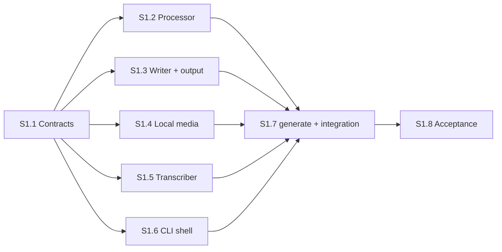

# Slice S1: Local File → Uploadable SRT — Tasks

> Consolidated task list for slice **S1** of SubSync v1. Each task is one work package from the [implementation roadmap](../../docs/product-engineering/subsync-v1/implementation-roadmap.md).
> Based on [phase-3-netflix-compliance.md](../plan/phase-3-netflix-compliance.md) and [phase-4-cli-output.md](../plan/phase-4-cli-output.md) (both revised 2026-09-25), the agreed [product brief](../../docs/product-design/subsync-v1/product-brief.md), [UX flows](../../docs/product-design/subsync-v1/ux-flows.md) and [handoff](../../docs/product-design/subsync-v1/handoff.md).

**Outcome**: Igor runs `subsync generate ep42.mov` on a real episode and uploads the resulting `ep42.en.srt` to YouTube Studio.

**Baseline**: `main` @ `2940f27` plus the planning commit that adds this file. Phases 1–2 are merged: 87 tests pass, ruff is clean.

**Dependencies**: Phase 2 complete
**Context**: [data-models.md](../context/data-models.md), [netflix-compliance.md](../context/netflix-compliance.md), [youtube-compatibility.md](../context/youtube-compatibility.md), [dependencies.md](../context/dependencies.md)

---

## Engineering Decisions Used by This Slice

Settled during planning on 2026-09-25. Details and rationale are in the phase-4 plan.

| ID | Decision |
|---|---|
| E2 | Local audio: `ffprobe` reads duration and detects "no audio" or "not decodable" (F9); FFmpeg extracts the default audio stream to 16 kHz mono WAV in the run's temp folder. There is no track selection. |
| E4 | One source-agnostic `generate()` orchestrator plus a `MediaSource` model. `SubtitleFile` drops `video_id`. S1 builds the file branch only; `process_video()` stays until S4. **Agreed by Igor.** |
| E7 | Test layers: unit, integration with real FFmpeg and a stand-in transcriber, an SRT invariant checker, and an opt-in e2e run (`pytest -m e2e`) on a clip generated at test time with macOS `say` and FFmpeg (Whisper `tiny`). No CI until S5. **Agreed by Igor.** |
| E8 | Transcription runs in-process. On Ctrl+C every stage unwinds, the FFmpeg child is stopped, temp files are removed, and SubSync exits 130 **within 2 s**. |
| E9 | SRT output: UTF-8 without BOM, LF line endings, one blank line between cues, and a single trailing newline. CPS counts spaces and punctuation but not line breaks. |
| — | Fast startup: stages 0–1 never import Whisper, torch or yt-dlp. Importing Whisper takes 1–2 s on Igor's Mac. Model and language lists are static, with a drift test. |
| — | Until S4, an INPUT that parses as a YouTube URL exits 2 with a hint to export the file and use the local-file route. |

---

## Slice-Level Acceptance Criteria

- [ ] `subsync generate <file>` writes `<input folder>/<stem>.<lang>.srt` and exits 0 (R1, R14)
- [ ] The written SRT passes the invariant checker: 0 overlaps, 0 gaps under 83 ms, no subtitle over 7 s, ≤ 2 lines, ≤ 42 chars except single long words (R8, R9, R12)
- [ ] Long words are unchanged and listed with their timestamp in the summary (R12)
- [ ] A second run exits 5 in about 1 s, before any extraction or model load (R15, U1)
- [ ] Missing FFmpeg fails in under 1 s with the install hint (R24)
- [ ] The file route makes no network calls once the model is cached (R4)
- [ ] Every S1 failure row (F1–F4, F6–F9, F11, F12, F19–F25) shows its message and next step; no traceback unless `-v` (R20, R21)
- [ ] Exit codes 0, 1, 2, 4, 5 and 130 are each covered by a CLI test (R22)
- [ ] Ctrl+C exits 130 within 2 s, writes nothing and leaves no temp files (R23)
- [ ] The opt-in e2e suite passes on Igor's Mac (`task test:e2e`)
- [ ] One real episode is uploaded to YouTube Studio "With timing" and accepted (A3); total time recorded for N1
- [ ] `task test` and `task lint` pass

### Requirement Coverage

| Req | Task(s) | Main check |
|---|---|---|
| R1 local file | S1.4, S1.7 | FFmpeg integration tests; CLI integration success case |
| R3 file side | S1.6 | `resolve_input` tests (file, folder, neither) |
| R4 offline | S1.7 | e2e offline run |
| R5 language shown and in name | S1.7 | Integration: summary line and `*.en.srt` |
| R6 `-l` | S1.6, S1.7 | F2 test; `(set with -l)` and exact-name pre-check |
| R7 `-m`, turbo, notice | S1.5, S1.6, S1.7 | Cache detection, F3, notice shown only when not cached |
| R8, R9, R10 (punctuation, balance), R12 | S1.2 | Processor unit tests + invariant checker |
| R14 file naming, `-o` | S1.3 | Naming table tests |
| R15 + U1 | S1.3, S1.7 | Pre-check tests; second-run integration test |
| R16 srt | S1.3, S1.6 | Render golden test; `-f` choices |
| R17 | S1.3 | Failure and interrupt write tests |
| R18 plain lines | S1.7 | stderr stage-line assertions |
| R19 path, count, flags | S1.7 | stdout summary assertions |
| R20 | S1.6 | Traceback only with `-v` |
| R21/R22 | S1.6, S1.7 | One test per failure row and per exit code |
| R23 | S1.4, S1.7 | Interrupt tests; e2e SIGINT |
| R24 | S1.4, S1.6, S1.7 | PATH-without-FFmpeg test; import-cost test |
| P2 | S1.2, S1.7 | Report structure; headline variants |

---

## Dispatch Rules (All Tasks)

- Read this task, the linked plan sections and the code named under **Baseline** before starting. Preserve other people's changes; touch only the files you own. If a shared file needs a change, stop and escalate.
- Conventions come from `AGENTS.md`: `uv` only, type hints, docstrings, `logging` not `print` (except CLI output), exceptions from `errors.py`, and `field(default_factory=lambda: [])`.
- Tests assert behavior through public interfaces. Never assert on private helpers. Keep them deterministic, with no network outside the opt-in e2e suite.
- Commits: only once Igor has authorized commits for this slice. Use Conventional Commits with a required scope and no AI attribution.
- **Escalate** when a contract below cannot be met as written, a requirement conflicts with another, a new dependency seems necessary, or a measured threshold (1 s, 2 s) is missed.
- Output: code and tests on the package branch, ticked acceptance criteria, and a short note listing commands run and their results.

---

## Task S1.1: Contracts and Test Scaffolding

**Objective**: Land the shared error categories, data models, SRT invariant checker and pytest configuration, so that S1.2–S1.6 can work in parallel on files that don't overlap.

**Detail Level**: EXPANDED

### Context

- **Plan**: [phase-4](../plan/phase-4-cli-output.md) → "Error Categories", "Interface Definitions → MediaSource"; [phase-3](../plan/phase-3-netflix-compliance.md) → "ComplianceReport (additions for v1)", "Millisecond Precision"
- **Baseline**: `src/subsync/errors.py` (6 classes, no hint), `src/subsync/models.py` (`SubtitleFile.video_id`, `ComplianceReport` without flags), `tests/test_models.py`. There is no pytest configuration in `pyproject.toml`.
- **Why first**: every other package raises these errors or reads these models. Merging them first keeps later work on separate files.

### Requirements

**Errors** (`src/subsync/errors.py`). The exit code is listed for the CLI mapping in S1.6.

| Class | Parent | Exit | Used for |
|---|---|---|---|
| `SubSyncError(message, hint=None)` | `Exception` | 1 | Base. `str(err)` is the message; `err.hint` is the optional next-step text, `None` by default |
| `InputError` | `SubSyncError` | 2 | F2–F4, F7, F8, interim URL message |
| `URLParseError` | `InputError` (reparented) | 2 | Existing; F10 in S4 |
| `MediaError` | `InputError` | 2 | F9 |
| `DependencyError` | `SubSyncError` | 1 | F6 |
| `SourceUnavailableError` | `SubSyncError` | 3 | Parent for the three below |
| `VideoUnavailableError`, `AgeRestrictedError`, `LiveStreamError` | `SourceUnavailableError` (reparented) | 3 | Existing |
| `TranscriptionError` | `SubSyncError` | 4 | F21 |
| `ModelDownloadError`, `ModelMemoryError`, `NoSpeechError` | `TranscriptionError` | 4 | F19, F20, F22 |
| `OutputError` | `SubSyncError` | 5 | F12, F23 |
| `OutputExistsError` | `OutputError` | 5 | F11 |

Existing call sites that pass only a message must keep working unchanged.

**Models** (`src/subsync/models.py`):
- `MediaSource`: `kind` (`"file"` or `"youtube"`), `display_name: str`, `output_stem: str`, `output_dir: Path`, `path: Path | None = None`, `duration: float | None = None`, `video_id: str | None = None`, `channel: str | None = None`
- `ComplianceFlag`: `kind` (`"short"`, `"long_word"`, `"cps"`), `subtitle_index: int`, `start_time: timedelta`, `detail: str = ""`
- `ComplianceReport` gains `flags: list[ComplianceFlag]`, defaulting to an empty list per instance
- `SubtitleFile` drops `video_id`
- `VideoMetadata`, `ProcessingConfig` (children fields included) and `TranscriptionConfig` are unchanged

**SRT invariant checker** (`tests/srt_invariants.py`, a test helper, **not** production code). Write it from the requirements, independently of the processor and writer:
- `parse_srt(data: bytes) -> list[Cue]`. A cue has its index, start ms, end ms and text lines. Fail with a clear message on bad grammar
- `check_cues(cues, config) -> list[str]` returns violations: indices not 1..n in order; `start >= end`; overlap or out of order; gap under 83 ms; duration over 7000 ms; 0 or more than 2 lines; a line over 42 characters unless it is a single word (no spaces)
- `assert_valid_srt(data: bytes, config)` also checks: UTF-8 decodable, no BOM, no `\r`, cues separated by exactly one blank line, a single trailing newline. It raises with all violations listed
- `short_cues(cues, config)` returns cues under 833 ms. These are **not** violations; callers compare them to the report's `short` flags

**Pytest configuration**:
- Register an `e2e` marker in `pyproject.toml`; the default run excludes it (`-m "not e2e"`)
- Add a `test:e2e` Taskfile task that runs `uv run pytest -m e2e`

### Acceptance Criteria

- [x] `isinstance` relationships in the table hold; `except SubSyncError` still catches every SubSync error
- [x] `SubSyncError("x").hint is None`; `SubSyncError("x", hint="y").hint == "y"`; `str()` is the message
- [x] New models exist with the fields above; two `ComplianceReport` instances do not share a `flags` list
- [x] `SubtitleFile` has no `video_id`; `tests/test_models.py` updated
- [x] The invariant checker catches each violation class listed in the test scenarios
- [x] `uv run pytest` runs the existing 87 tests plus the new ones and skips `e2e`; `uv run ruff check .` passes

### Test Scenarios

| # | Scenario | Layer | Expected |
|---|---|---|---|
| 1 | Hierarchy table, parametrized | unit | Each class is an instance of its parent and of `SubSyncError` |
| 2 | Hint default and explicit | unit | `None` / given text |
| 3 | `MediaSource` for `~/Videos/ep42.mov` | unit | Fields hold; YouTube fields are `None` |
| 4 | Two reports, append to one `flags` | unit | The other stays empty |
| 5 | Valid 3-cue SRT, including a 2-line cue and a time over 1 h | unit | No violations |
| 6 | One mutation per rule: overlap, 82 ms gap, 7001 ms, 3 lines, 43-char two-word line, index gap, BOM, CRLF, missing final newline, bad timestamp | unit | Exactly that violation reported |
| 7 | 49-character URL alone on a line | unit | Not a violation |
| 8 | 500 ms cue | unit | Listed by `short_cues`, not a violation |

**Plausible wrong implementations these tests reject**: a checker that only inspects the first cue, or that imports the processor or writer; a shared mutable `flags` default; `URLParseError` no longer caught as `SubSyncError`.

### Ownership and Dispatch

- **Owns**: `src/subsync/errors.py`, `src/subsync/models.py`, `tests/test_models.py`, `tests/test_errors.py` (new), `tests/srt_invariants.py` (new), `tests/test_srt_invariants.py` (new), `pyproject.toml` (pytest section only), `Taskfile.yml`
- **Prerequisites**: none. **Blocks**: S1.2–S1.6
- **Tier**: standard model, low effort; about 1 hour

### Definition of Done

- All acceptance criteria met; after merging to the slice branch, S1.2–S1.6 branch from that commit

---

## Task S1.2: Subtitle Processor (Core)

**Objective**: Turn a `TranscriptionResult` into ordered, whole-millisecond `Subtitle` events plus a `ComplianceReport`, meeting R8, R9, the S1 part of R10, R12 and P2.

**Detail Level**: EXPANDED

### Context

- **Plan**: [phase-3](../plan/phase-3-netflix-compliance.md): the whole document; S1 scope in "Delivery by slice"
- **Dependencies**: S1.1 (`ComplianceFlag`, `ComplianceReport.flags`, invariant checker). Existing models `TranscriptionResult`, `TranscriptionSegment`, `Word`, `Subtitle`, `ProcessingConfig` (42 chars, 2 lines, 833–7000 ms, 83 ms gap, 20 CPS)
- **Whisper input quirks**: word texts carry leading spaces (`" word"`) and attached punctuation; timestamps can overlap between segments, have zero length, or run backwards; segments can be empty; `words` can be empty

### Interface Contract

```
process_transcription(result: TranscriptionResult,
                      config: ProcessingConfig | None = None)
    -> tuple[list[Subtitle], ComplianceReport]
```

- A new module, `src/subsync/processor.py`. Internal decomposition is up to the implementer
- Never raises for content problems. An empty or all-blank transcript returns `([], report)` with `total_subtitles == 0` and no errors

### Requirements (S1 scope)

1. **Cleanup**: drop empty or whitespace-only segments; normalize whitespace in word text. (Collapsing repeats, R13, is S2.)
2. **Split** at word boundaries using word timestamps whenever a chunk would last over 7000 ms or could not be laid out in 2 lines of 42 characters. Prefer boundaries after `. , ! ? : ;`. Without word timestamps, interpolate word times across the segment in proportion to character count.
3. **Timing**: start and end come from the chunk's first and last word. A subtitle under 833 ms is extended into free time, up to `next start − 83 ms` and 7000 ms total. If it stays short, keep it and add a `short` flag (P1 merging is S2). Gaps under 83 ms and overlaps are fixed without breaking `end > start`. Every subtitle ends up ordered, non-overlapping, ≤ 7000 ms, and at least 83 ms from its neighbors.
4. **Lines**: text of ≤ 42 characters stays on 1 line; otherwise 2 lines of ≤ 42. Prefer a break after punctuation, then the most balanced split. The English article/preposition rule is S2.
5. **Long words (R12)**: a word over 42 characters is never shortened. It sits alone on its line; the other line may hold text that fits, otherwise that text moves to a neighboring subtitle. Add a `long_word` flag with the subtitle's index and start time.
6. **Text preservation**: the sequence of words in the output equals the sequence of non-empty words in the input, ignoring whitespace. Nothing is dropped, truncated, reordered or rewritten, and case and Unicode are kept.
7. **Precision**: every `start_time` and `end_time` is a whole number of milliseconds.
8. **Numbering**: `index` runs 1..n in time order.
9. **Report (P2)**: `total_subtitles`; `timing_issues` = number of `short` flags; `line_length_issues` = number of `long_word` flags; `flags` sorted by start time; `errors` = structural problems found by a final self-check (overlap, disorder, `end <= start`, more than 2 lines), which should always be empty; `is_compliant = not errors`; `warnings` = one human-readable line per flag.

### Acceptance Criteria

- [ ] Every test fixture's output passes `check_cues` from S1.1, and its `short_cues` match the report's `short` flags
- [ ] The text-preservation property holds for every fixture
- [ ] All times are whole milliseconds
- [ ] A 49-character URL comes out unchanged and flagged with its timestamp
- [ ] A 150-character sentence becomes 2 or more subtitles within 2 × 42, each starting at one of its word timestamps
- [ ] A seeded randomized test (fixed seed, about 200 adversarial transcripts built with the stdlib `random`) passes the invariants and text preservation
- [ ] `uv run pytest tests/test_processor.py` and `uv run ruff check .` pass

### Test Scenarios

All unit tests with hand-built `TranscriptionResult` fixtures (no Whisper, no files). Where helpful, fixtures are JSON under `tests/fixtures/transcripts/`.

| # | Scenario | Expected |
|---|---|---|
| 1 | Two short sentences, clean timestamps | 2 subtitles, times from words, 1 line each |
| 2 | 150-char sentence with word timestamps | ≥ 2 subtitles, each ≤ 2 × 42, split at word starts |
| 3 | One 9 s, 60-char segment | Split; every piece ≤ 7000 ms |
| 4 | 400 ms "Yes." followed by 2 s of silence | Extended to ≥ 833 ms, not flagged |
| 5 | 400 ms "Yes." with the next speech 450 ms later | Kept short, flagged `short`, gap ≥ 83 ms |
| 6 | Segment 2 starts 300 ms before segment 1 ends | No overlap, gap ≥ 83 ms |
| 7 | 40 ms gap between segments | Gap ≥ 83 ms |
| 8 | 120-char segment with `words=[]` | Split with interpolated times; invariants hold |
| 9 | Zero-length words, identical timestamps, a backwards word | `end > start` everywhere; order kept |
| 10 | Sentence containing `github.com/ikcode-dev/subsync/blob/main/README.md` | URL unchanged on its own line; `long_word` flag at that subtitle's start |
| 11 | "We install the package, then we run the tests" (46 chars) | Break after the comma |
| 12 | 60 chars without punctuation | 2 lines ≤ 42, no one-word orphan line when a balanced split exists |
| 13 | Only blank segments | `[]`, total 0, no errors |
| 14 | "ZAŻÓŁĆ GĘŚLĄ JAŹŃ" and emoji | Preserved exactly |
| 15 | A single word timed 0–9 s | One subtitle ≤ 7000 ms |
| 16 | Seeded random adversarial transcripts | Invariants and text preservation hold |

**Plausible wrong implementations these tests reject**: truncating long words with `…` (#10); dropping words to fit 84 characters (preservation property); rounding only at write time (whole-ms check); fixing overlaps by making `end <= start` (#9); splitting only on duration and never on length (#2); a per-segment pass that ignores gaps across segment boundaries (#6, #7).

### Ownership and Dispatch

- **Owns**: `src/subsync/processor.py` (new), `tests/test_processor.py` (new), `tests/fixtures/transcripts/` (new)
- **Prerequisites**: S1.1 merged. **Runs in parallel with**: S1.3, S1.4, S1.5, S1.6
- **Tier**: the strongest available model with high effort. This is the most algorithmic package and the easiest place to hide invariant bugs

### Definition of Done

- All acceptance criteria met; the report and the invariant helpers agree on every fixture

---

## Task S1.3: SRT Writer and Output Planner

**Objective**: Decide where the subtitle file goes, refuse to overwrite it without `--force` before any work starts, and write valid SRT in one step so no partial file can exist.

**Detail Level**: EXPANDED

### Context

- **Plan**: [phase-4](../plan/phase-4-cli-output.md) → "Output File Naming", "Fail Fast on Existing Output", "One-Step Write", "SRT Serialization"
- **UX**: F4, F11, F12, F23 in the [failure table](../../docs/product-design/subsync-v1/ux-flows.md#states-failures-and-recovery)
- **Dependencies**: S1.1 (`MediaSource`, `OutputError`, `OutputExistsError`, `InputError`, invariant checker)

### Interface Contract

New modules, `src/subsync/output.py` and `src/subsync/writer.py`:

```
check_output_args(output_arg: str | None, fmt: str) -> None          # F4, stage 0
plan_output(source: MediaSource, output_arg: str | None, fmt: str,
            language: str | None, force: bool) -> OutputPlan         # F11, F12, stage 1
OutputPlan.path_for(language: str) -> Path                            # absolute path
render_srt(subtitles: list[Subtitle]) -> str
write_output(content: str, path: Path, force: bool) -> None           # F11 re-check, F23
```

### Requirements

**Naming (R14)**
- Default: `<source.output_dir>/<source.output_stem>.<lang>.<fmt>`
- `-o` naming an existing folder, or ending in `/` → the default name inside it
- Any other `-o` → exactly that path; relative paths resolve against the current folder
- `path_for` always returns an absolute path. Multi-dot stems are kept (`my.talk.final.mov` → `my.talk.final.en.srt`)

**Format check (F4)**: if `-o` ends in `.srt` or `.vtt` and that differs from `fmt`, raise `InputError("Output name ends in .vtt but --format is srt.", hint=...)`. (In S1, `fmt` is always `srt`; S5 adds inference.)

**Pre-check (R15, U1)**, skipped with `force`:
- Exact path known (a language was given, or `-o <file>`) and it exists → `OutputExistsError("ep42.en.srt already exists.", hint="Re-run with --force to replace it, or choose another path with -o.")`
- Default name with an auto-detected language → refuse if **any** file named `<stem>.<something>.<fmt>` exists in the output folder. Match literally: a stem containing `[`, `*` or `?` is not a pattern
- Output folder missing, or the parent of an exact path missing → `OutputError("Can't write to out/: <reason>.")`. Folders are never created. A folder that isn't writable → the same error with the OS reason

**Rendering (R16, E9)**: cue number (1..n by list position), `HH:MM:SS,mmm --> HH:MM:SS,mmm`, then 1–2 lines, with cues separated by exactly one blank line and one trailing newline. Hours are zero-padded to 2 digits. The output passes `assert_valid_srt` from S1.1 for any valid subtitle list.

**One-step write (R17)**:
- Encode as UTF-8 without BOM. Write the whole content to a temporary file in the target folder, then publish it under the final name in one step
- Without `force`, publishing fails if the name exists → `OutputExistsError` (U1 write-time re-check), and the existing file is untouched
- With `force`, the existing file is replaced
- Any `OSError` → `OutputError("Couldn't write ep42.en.srt: <OS reason>.")`
- On every failure path, including `KeyboardInterrupt`, the temporary file is removed and no final file appears; `KeyboardInterrupt` is re-raised unchanged
- The final file gets normal permissions for the user's umask, not the 0600 that temp-file helpers create

### Acceptance Criteria

- [ ] Naming table, pre-check and F4/F12 cases pass (scenarios 1–12)
- [ ] `render_srt` matches a golden string exactly and passes `assert_valid_srt`
- [ ] A failure injected mid-write leaves neither a temp file nor a final file
- [ ] An existing file is never replaced without `force`, at either check
- [ ] `uv run pytest tests/test_output.py tests/test_writer.py` and `uv run ruff check .` pass

### Test Scenarios

Unit and filesystem tests use `tmp_path` and real files; nothing is mocked except the injected failures.

| # | Scenario | Expected |
|---|---|---|
| 1 | Source `~/Videos/ep42.mov`, no `-o`, language `en` | `~/Videos/ep42.en.srt` (absolute) |
| 2 | `-o out/` (exists) | `out/ep42.en.srt` |
| 3 | `-o out/` (missing) | `OutputError` F12; `out/` not created |
| 4 | `-o subs/final.srt` (parent exists) | Exactly that path |
| 5 | `-o final.vtt` with `fmt=srt` | `InputError` F4 |
| 6 | Auto language, `ep42.de.srt` exists | `OutputExistsError` naming it |
| 7 | `-l en`, only `ep42.de.srt` exists | Allowed |
| 8 | Auto language, `ep42.de.srt` exists, `force` | Allowed |
| 9 | Stem `ep[1]`, and a file `ep1.en.srt` exists | Allowed (literal match) |
| 10 | Stem `my.talk.final` | `my.talk.final.en.srt` |
| 11 | Output folder read-only | `OutputError` with the OS reason |
| 12 | Path with spaces and non-ASCII letters | Works |
| 13 | Render 2 cues (1-line and 2-line, one past 1 h) | Golden string; no BOM; LF only |
| 14 | `write_output`, target exists, no `force` | `OutputExistsError`; original bytes unchanged; no temp file left |
| 15 | `write_output` with `force` | Replaced |
| 16 | The underlying write raises `OSError(ENOSPC)` | `OutputError` with reason; no temp, no final file |
| 17 | `KeyboardInterrupt` during the write | Re-raised; no temp, no final file |
| 18 | File mode after writing | Same as a file created normally in that folder |

**Plausible wrong implementations these tests reject**: writing straight to the final path (#16, #17); `os.replace` without a no-clobber path (#14); glob-based matching (#9); returning relative paths (#1); a 0600 final file (#18).

### Ownership and Dispatch

- **Owns**: `src/subsync/output.py`, `src/subsync/writer.py`, `tests/test_output.py`, `tests/test_writer.py` (all new)
- **Prerequisites**: S1.1. **Parallel with**: S1.2, S1.4, S1.5, S1.6
- **Tier**: standard model, medium effort

### Definition of Done

- All acceptance criteria met

---

## Task S1.4: Local Media via FFmpeg

**Objective**: Check that FFmpeg is present, read a local file's duration while detecting "no audio" and "unreadable", and extract a 16 kHz mono WAV offline.

**Detail Level**: EXPANDED

### Context

- **Plan**: [phase-4](../plan/phase-4-cli-output.md) → "Local Audio via FFmpeg (E2)", "Cancellation (R23, E8)"; [dependencies.md](../context/dependencies.md) → FFmpeg
- **UX**: F6, F9
- **Environment**: FFmpeg 9.0.1 and ffprobe at `/opt/homebrew/bin` on Igor's Mac. Tests that need FFmpeg skip cleanly when it's absent
- **Dependencies**: S1.1 (`DependencyError`, `MediaError`)

### Interface Contract

A new module, `src/subsync/media.py`:

```
check_ffmpeg() -> None                                  # DependencyError (F6)
probe_media(path: Path) -> float                        # duration in seconds; MediaError (F9)
extract_audio(path: Path, output_dir: Path) -> Path     # 16 kHz mono PCM WAV; MediaError
```

### Requirements

- `check_ffmpeg`: both `ffmpeg` and `ffprobe` must be on `PATH`, otherwise `DependencyError("FFmpeg is required but wasn't found.", hint="Install it with: brew install ffmpeg")`. It starts no subprocess and returns instantly
- `probe_media`: no audio stream → `MediaError("No audio track found in ep42.mov.")`; not decodable → `MediaError("Can't read ep42.mov as audio or video.")`. Duration comes from the container, falling back to the audio stream. The file's content decides, not its extension (mp4, mov, mkv, webm, m4a, mp3, wav must all work)
- `extract_audio`: FFmpeg's default audio stream → 16 kHz, mono, 16-bit PCM WAV inside `output_dir`. Failure → `MediaError` with a one-line reason; FFmpeg's stderr goes to debug logging only
- **Safety**: always pass arguments as a list with absolute paths, never through a shell. Names with spaces, quotes, `$()`, a leading `-` or non-ASCII letters must work
- **Terminal hygiene**: FFmpeg never reads the terminal's stdin, and nothing from FFmpeg is printed
- **Cancellation**: if SubSync is interrupted while FFmpeg runs, the child process is gone within 2 s and `KeyboardInterrupt` propagates unchanged
- **Offline**: no network access (R4)

### Acceptance Criteria

- [ ] Scenarios 1–10 pass against real FFmpeg; scenario 11 passes without FFmpeg
- [ ] `capfd` shows no FFmpeg output during any call
- [ ] Also create `tests/media_fixtures.py`: helpers that generate test media with FFmpeg's built-in sources (tone with or without video, video-only, multi-track, garbage bytes). S1.7 reuses them
- [ ] `uv run pytest tests/test_media.py` and `uv run ruff check .` pass

### Test Scenarios

Integration tests with **real FFmpeg** on clips generated at test time (a few seconds each). Nothing about FFmpeg is mocked except where a scenario says so.

| # | Scenario | Expected |
|---|---|---|
| 1 | 3 s `tone.mp4` (color video and sine audio) | `probe_media` ≈ 3.0 s (±0.1) |
| 2 | Same clip as `.mov`, `.mkv`, `.webm`, `.m4a`, `.mp3`, `.wav` (skip a format whose encoder is missing) | Duration returned; extraction works |
| 3 | Video-only `silent-video.mp4` | `MediaError` "No audio track found in silent-video.mp4." |
| 4 | Random bytes named `garbage.mov` | `MediaError` "Can't read garbage.mov as audio or video." |
| 5 | `extract_audio(tone.mp4)` | WAV exists; ffprobe reports pcm_s16le, 16000 Hz, 1 channel, ≈ 3 s |
| 6 | Two audio tracks | Extraction succeeds using the default stream |
| 7 | File named `name with spaces & $(echo x).mp4` | Works; no shell interpretation |
| 8 | File named `-leading.mp4` | Works |
| 9 | Every call | Nothing on stdout or stderr |
| 10 | A fake `ffmpeg` on `PATH` that sleeps 30 s and records its PID; interrupt `extract_audio` after 0.5 s with a signal handler that raises `KeyboardInterrupt` | `KeyboardInterrupt` propagates; the recorded PID has exited within 2 s |
| 11 | `PATH` with no `ffmpeg`; `PATH` with `ffmpeg` but no `ffprobe` | `DependencyError` with the brew hint |

**Plausible wrong implementations these tests reject**: string commands through a shell (#7, #8); trusting the file extension (#4); detecting "no audio" only when extraction fails later (#3 is raised by `probe_media`); an orphaned FFmpeg after Ctrl+C (#10); leaked FFmpeg banners (#9).

### Ownership and Dispatch

- **Owns**: `src/subsync/media.py`, `tests/test_media.py`, `tests/media_fixtures.py` (all new)
- **Prerequisites**: S1.1. **Parallel with**: S1.2, S1.3, S1.5, S1.6
- **Tier**: standard model, medium effort

### Definition of Done

- All acceptance criteria met

---

## Task S1.5: Transcriber — Separate Model Loading, Clear Errors, Quiet Output

**Objective**: Split model loading from transcription, so the CLI can show a one-time download notice and separate stage lines, turn Whisper failures into F19, F20 and F21, and keep Whisper's own output off the terminal.

**Detail Level**: EXPANDED

### Context

- **Plan**: [phase-4](../plan/phase-4-cli-output.md) → "Interface Definitions → Transcriber (additions to Phase 2)"
- **Baseline**: `src/subsync/transcriber.py`. `transcribe_audio()` loads and transcribes in one call, raises `TranscriptionError`, and resolves the device to `cuda` or `cpu`. `tests/test_transcriber.py` mocks `whisper` at the module boundary
- **Whisper facts (openai-whisper 20250625)**: weights are cached in `$XDG_CACHE_HOME/whisper` or `~/.cache/whisper`, under the basename of the model's download URL (e.g. `turbo` → `large-v3-turbo.pt`). A first download prints a tqdm bar to stderr. Transcribing on CPU warns "FP16 is not supported on CPU; using FP32 instead". The default `verbose=None` prints no transcription progress
- **Dependencies**: S1.1 (`ModelDownloadError`, `ModelMemoryError`, `TranscriptionError`)

### Interface Contract

In `src/subsync/transcriber.py`:

```
is_model_cached(model_name: str) -> bool
load_model(config: TranscriptionConfig) -> LoadedModel     # LoadedModel: name, device label ("CPU" | "CUDA"), engine handle
transcribe_with_model(model: LoadedModel, audio_path: Path, config: TranscriptionConfig,
                      progress_callback: Callable[[float], None] | None = None)
    -> TranscriptionResult
transcribe_audio(...)   # unchanged signature and behavior, now composed of the two above
```

### Requirements

- `load_model` errors:
  - Model not cached and download fails (network, HTTP or checksum) → `ModelDownloadError("Couldn't download model 'turbo': <reason>.", hint="An internet connection is needed once per model.")`
  - Out of memory (`MemoryError`, or `RuntimeError` mentioning out of memory) → `ModelMemoryError("Ran out of memory with model 'large-v3'.", hint="Try a smaller one: -m small")`
  - Anything else → `TranscriptionError`
- `transcribe_with_model` errors: out of memory → `ModelMemoryError`; otherwise `TranscriptionError("Transcription failed: <reason>.", hint="Re-run with -v for details.")`
- `KeyboardInterrupt` is never caught or wrapped
- **Quiet**: Whisper's download bar and warnings do not reach stdout or stderr. They go to `logging` at debug level, suppressed only around Whisper calls rather than for the whole process
- The device label is uppercase for display. MPS is not used; the E1 spike decides engines
- The language code in `TranscriptionResult` is Whisper's code (`en`) as today
- The existing `transcribe_audio` tests keep passing; `process_video()` is untouched

### Acceptance Criteria

- [ ] Scenarios 1–9 pass with Whisper mocked at the module boundary, as in the existing tests
- [ ] `import subsync.transcriber` still works. Import cost is acceptable here because the CLI imports this module lazily (S1.7)
- [ ] `uv run pytest tests/test_transcriber.py` and `uv run ruff check .` pass

### Test Scenarios

| # | Scenario | Expected |
|---|---|---|
| 1 | `XDG_CACHE_HOME=tmp`, weight file present / absent | `is_model_cached` True / False |
| 2 | Not cached; the mocked loader raises `URLError` | `ModelDownloadError` with the hint |
| 3 | Cached; the loader raises `RuntimeError("boom")` | `TranscriptionError`, not a download error |
| 4 | The loader raises "CUDA out of memory" or `MemoryError` | `ModelMemoryError` naming the model |
| 5 | The mocked transcribe raises "out of memory" | `ModelMemoryError` |
| 6 | The mocked transcribe raises `KeyboardInterrupt` | Propagates as `KeyboardInterrupt` |
| 7 | The mocked transcribe emits `warnings.warn("FP16 …")` and prints a bar to stderr | `capfd` is empty; `caplog` has a debug record |
| 8 | `LoadedModel` for CPU | Device label `CPU` |
| 9 | Existing `transcribe_audio` scenarios | Unchanged results |

**Plausible wrong implementations these tests reject**: catching `BaseException` (#6); treating every load failure as a download failure (#3); silencing warnings for the whole process; losing `transcribe_audio` compatibility (#9).

### Ownership and Dispatch

- **Owns**: `src/subsync/transcriber.py`, `tests/test_transcriber.py`
- **Prerequisites**: S1.1. **Parallel with**: S1.2, S1.3, S1.4, S1.6
- **Tier**: standard model, medium effort

### Definition of Done

- All acceptance criteria met

---

## Task S1.6: CLI Shell — Arguments, Catalog, Input Resolution, Errors, Exit Codes

**Objective**: Build the `subsync generate` command surface for S1, input resolution for local files, and the single error boundary that turns every outcome into the right message and exit code, without importing the ML stack on fast paths.

**Detail Level**: EXPANDED

### Context

- **Plan**: [phase-4](../plan/phase-4-cli-output.md) → "CLI Interface", "Error Categories", "Exit Codes", "Fast Startup", "Streams (U6)"
- **UX**: [command surface](../../docs/product-design/subsync-v1/ux-flows.md#command-surface); F1–F3, F7, F8, F24, F25
- **Baseline**: `src/subsync/cli.py` prints "Hello World". The `pyproject.toml` script `subsync = "subsync.cli:main"` stays as is (console scripts call `sys.exit(main())`)
- **Dependencies**: S1.1 (error classes, `MediaSource`), plus `url_handler.parse_youtube_url` (existing)

### Interface Contract

```
cli.main(argv: list[str] | None = None) -> int
catalog.MODEL_NAMES: tuple[str, ...]            # snapshot of whisper.available_models()
catalog.LANGUAGES: dict[str, str]               # code → English name, e.g. "en" → "English"
catalog.language_name(code: str) -> str
sources.resolve_input(raw: str) -> MediaSource  # file branch only in S1
```

The command then calls a single seam, run-generate(parsed options) → exit code. S1.7 implements it. In this task it stops after input resolution, so the error paths above can be tested.

### Requirements

- **Command**: `subsync generate INPUT [-l CODE] [-m NAME] [-f srt] [-o PATH] [--force] [-v]`, plus `--version` and `-h`. Bare `subsync`, or `generate` without INPUT → usage, exit 2. `-f` accepts only `srt` in S1. The layout leaves room for future subcommands
- **Validation at stage 0** (exit 2): `-l xx` → `Unknown language code 'xx'.` with hint `Use a code such as en, pl, de.` (F2); `-m banana` → `Unknown model 'banana'.` with a hint listing the valid names (F3); other argparse errors → usage and the problem (F1)
- **Input resolution** (`sources.resolve_input`):
  - Existing file → `MediaSource(kind="file", display_name=<name>, output_stem=<stem>, output_dir=<absolute parent>, path=<absolute path>)`
  - Folder → `InputError("'clips/' is a folder, not a media file.")` (F8)
  - Parses as a YouTube URL → interim `InputError("YouTube links aren't supported yet.", hint="Export or download the video and run: subsync generate <file>")`
  - Anything else → `InputError("'foo' is not a file or a supported YouTube URL.", hint=<an example command>)` (F7)
- **Error boundary** in `main`:
  - `SubSyncError` → ✗ block on stderr (headline, then the hint indented), exit code by category (S1.1 table)
  - `KeyboardInterrupt` → `Cancelled. Nothing written.`, exit 130
  - Any other exception → `Something went wrong: <one-line summary>.` with hint `Re-run with -v and share the output.`, exit 1 (F25)
  - Without `-v`, never a traceback. With `-v`, debug logging to stderr and the traceback printed before the ✗ block
  - Nothing on stdout for any failure
- **Fast paths**: importing `subsync.cli` and running any stage 0–1 failure must not import `whisper`, `torch` or `yt_dlp`
- **Catalog drift**: a test compares `MODEL_NAMES` and `LANGUAGES` codes with the installed Whisper and fails on any difference

### Acceptance Criteria

- [ ] Scenarios 1–14 pass
- [ ] `uv run pytest tests/test_cli.py tests/test_catalog.py tests/test_sources.py` and `uv run ruff check .` pass

### Test Scenarios

Unit tests call `main(argv)` in-process with `capsys`. Scenario 13 uses a subprocess.

| # | Scenario | Expected exit / output |
|---|---|---|
| 1 | `--version` | 0; `subsync 0.1.0` |
| 2 | Bare `subsync`; `subsync generate` | 2; usage |
| 3 | `generate x --bogus` | 2; usage and problem (F1) |
| 4 | `-l xx` | 2; F2 message and hint |
| 5 | `-m banana` | 2; F3 message listing names |
| 6 | `-f vtt` | 2; invalid choice (VTT arrives in S5) |
| 7 | INPUT `foo` (missing) | 2; F7 |
| 8 | INPUT is a folder | 2; F8 |
| 9 | INPUT `https://youtu.be/dQw4w9WgXcQ` | 2; interim URL message |
| 10 | Seam raises each S1.1 error class (parametrized) | The mapped exit code; headline and hint on stderr; stdout empty |
| 11 | Seam raises `KeyboardInterrupt` | 130; `Cancelled. Nothing written.` |
| 12 | Seam raises `ValueError("x")`, without / with `-v` | 1; no traceback / traceback |
| 13 | Subprocess: import `subsync.cli`, run `main(["generate", "missing.mov"])`, print whether `torch`, `whisper` or `yt_dlp` is in `sys.modules` | Prints False |
| 14 | Catalog versus installed Whisper | Identical |

**Plausible wrong implementations these tests reject**: validating models with a top-level `import whisper` (#13); printing errors to stdout (#10); exit 1 on Ctrl+C (#11); tracebacks without `-v` (#12).

### Ownership and Dispatch

- **Owns**: `src/subsync/cli.py`, `src/subsync/catalog.py`, `src/subsync/sources.py`, `tests/test_cli.py`, `tests/test_catalog.py`, `tests/test_sources.py`
- **Prerequisites**: S1.1. **Parallel with**: S1.2–S1.5. S1.7 extends `cli.py` afterwards
- **Tier**: standard model, medium effort

### Definition of Done

- All acceptance criteria met; the seam is clearly marked for S1.7

---

## Task S1.7: `generate()` — Orchestration, Stage Lines, Summary, Cancellation (Integration)

**Objective**: Wire S1.2–S1.6 into `subsync generate <file>`: run the stages in the fail-fast order, show plain stage lines and the summary, map every failure, clean up on every exit path, and prove it end-to-end with the opt-in suite.

**Detail Level**: EXPANDED

### Context

- **Plan**: [phase-4](../plan/phase-4-cli-output.md) → Flow, "Orchestrator", "Progress Display", "Summary", "Cancellation"
- **UX**: the [success transcript](../../docs/product-design/subsync-v1/ux-flows.md#success-local-file-first-run-with-glossary-terminal) (S1 subset), [cancel transcript](../../docs/product-design/subsync-v1/ux-flows.md#cancel), [output-exists transcript](../../docs/product-design/subsync-v1/ux-flows.md#failure-output-already-exists)
- **Baseline to reuse**: `pipeline.pipeline_temp_dir()`; `process_video()` stays untouched until S4
- **Dependencies**: S1.2 `process_transcription`; S1.3 `check_output_args`, `plan_output`, `render_srt`, `write_output`; S1.4 `check_ffmpeg`, `probe_media`, `extract_audio`, `tests/media_fixtures.py`; S1.5 `is_model_cached`, `load_model`, `transcribe_with_model`; S1.6 `main`, the seam, `catalog`, `resolve_input`

### Requirements

**Stage order** (fail fast; the ML stack is imported only after step 5):

```
0  parse and validate args (S1.6) · check_output_args (F4) · check_ffmpeg (F6)
1  resolve_input (F7, F8) → plan_output pre-check (F11, F12)
1F probe_media (F9) → print source line → extract_audio into pipeline_temp_dir
2  if not cached: "Downloading model 'turbo' (one-time)…" → load_model (F19, F20)
3  transcribe_with_model (F20, F21) → language line
4  process_transcription → 0 subtitles → NoSpeechError (F22), nothing written
5  render_srt → write_output to plan.path_for(language) (F11 re-check, F23)
6  summary on stdout → exit 0
```

**`generate()`** (in `src/subsync/pipeline.py`) takes the resolved `MediaSource`, the transcription and processing configs, the output plan, format, force and a stage-event receiver. It returns the written path, the language and whether it was detected, model name and device label, subtitle count, report and stage timings. It must not print anything itself; the CLI renders its events.

**Stage lines** (stderr, plain, one per event; wording per the UX transcript):

```
ep42.mov · 14:52 · local file
✓ Extracted audio                                        4s
  Downloading model 'turbo' (one-time)…                        (only when not cached)
✓ Loaded model turbo on CPU                             11s
  Transcribing 14:52 of audio…
✓ Transcribed                                       6m 02s
  Language: English (auto-detected)        | (set with -l)
✓ Formatted 312 segments → 356 subtitles
✓ Wrote subtitles
```

**Summary** (stdout):
- Headline per P2: `✓ Subtitles written` / `✓ Subtitles written, N to review` / `✗ Written but not compliant, please report with -v output` (still exit 0)
- `File:` absolute path, never shortened; `Source:` name · duration; `Language:` name and (auto-detected | set with -l); `Model:` name on device · total time; `Subtitles:` count
- Flagged subtitles: first 5 by time as `HH:MM:SS  <preview…>  <kind>`, with the preview cut to the terminal width (display only), then `… N more (run with -v to list all)`; with `-v`, all of them
- `Next: YouTube Studio → Subtitles → your video → Add → Upload file → With timing`
- The full compliance block comes in S2

**Cleanup and cancellation**: the temp folder is removed on every exit path. Ctrl+C at any stage → exit 130 within 2 s, `Cancelled. Nothing written.`, no output file, no temp folder left.

**Offline**: once the model is cached, the file route opens no network connections (R4).

**Docs**: update the key-modules list in `AGENTS.md` for the new modules; tick the acceptance criteria in this file.

### Acceptance Criteria

- [ ] Integration scenarios I1–I18 pass in the default suite
- [ ] E2E scenarios E1–E4 pass with `task test:e2e` on Igor's Mac
- [ ] The slice-level acceptance criteria, except the manual ones in S1.8, are ticked
- [ ] `uv run pytest`, `uv run pytest -m e2e` and `uv run ruff check .` pass

### Test Scenarios

**Integration** (default suite): real FFmpeg on generated clips (S1.4 helpers), the real processor, output planner and writer, and the real CLI through `main(argv)`. The **transcriber is replaced at its module boundary** (`load_model` and `transcribe_with_model`) by a stand-in that returns a canned `TranscriptionResult` from `tests/fixtures/transcripts/` and counts its calls. `TMPDIR` points to a test folder so leftover temp folders can be detected.

| # | Scenario | Expected |
|---|---|---|
| I1 | `generate tone.mp4` (fixture transcript includes a 49-char URL) | 0; `tone.en.srt` next to the input passes `assert_valid_srt`; stdout has the summary with the absolute path and the flag's timestamp; stderr has the stage lines only |
| I2 | Same with `-l en` | `(set with -l)`; transcriber called with language `en` |
| I3 | Second run | 5; F11 message; transcriber and `extract_audio` **not called**; file bytes unchanged |
| I4 | Auto language and an existing `tone.de.srt` | 5 |
| I5 | `--force` | 0; replaced |
| I6 | `-o out/` / `-o missing/` / `-o x.vtt` | `out/tone.en.srt` / exit 5 F12 / exit 2 F4 |
| I7 | Video without audio | 2; F9; model never loaded |
| I8 | Transcript with no segments | 4; F22; no file |
| I9 | Stand-in raises `ModelDownloadError` / `ModelMemoryError` / `TranscriptionError` | 4 with the F19 / F20 / F21 text |
| I10 | Model not cached | Download notice shown before the load line |
| I11 | Stand-in raises `KeyboardInterrupt` during transcription | 130; `Cancelled. Nothing written.`; no output file; no `subsync_*` folder left |
| I12 | `KeyboardInterrupt` injected during the write | Same as I11 |
| I13 | `PATH` without FFmpeg | 1; F6; nothing else attempted |
| I14 | Processor replaced to return a report with a structural error | 0; `✗ Written but not compliant…` headline |
| I15 | Processor raises `ValueError` | 1; F25; no traceback; with `-v`, a traceback |
| I16 | Streams | Summary only on stdout; progress and errors only on stderr |
| I17 | More than 5 flags; with and without `-v` | 5 listed and `… N more`; with `-v`, all listed |
| I18 | Subprocess: F11 and F6 paths | `torch`, `whisper` and `yt_dlp` not imported |

**End-to-end** (`@pytest.mark.e2e`, skipped unless selected, and when `say` or FFmpeg is missing). Real Whisper `tiny`, on a speech clip generated at test time with macOS `say` and FFmpeg (a few English sentences muxed with a color video track into `talk.mp4`). Run SubSync as the installed `subsync` console script in a subprocess, except E2.

| # | Scenario | Expected |
|---|---|---|
| E1 | `subsync generate talk.mp4 -m tiny` | 0; `talk.en.srt` passes `assert_valid_srt`; ≥ 1 subtitle; summary shows English; stderr has no Whisper/FFmpeg noise (no `FP16`, no progress bars) |
| E2 | Model cached; run in-process with every outbound connection made to fail | 0 (R4) |
| E3 | Second run | 5 in under 1.5 s wall time |
| E4 | ~60 s clip; send SIGINT once `Transcribing` appears on stderr | 130 within 2 s; `Cancelled. Nothing written.` last on stderr; no output file; no new `subsync_*` folder |

**Plausible wrong implementations these tests reject**: loading the model or extracting audio before the pre-check (I3 call counts); a summary on stderr (I16); temp folders left after Ctrl+C (I11, E4); a top-level ML import (I18); a Whisper warning leaking in real use (E1); an exit code other than 0 when structural errors exist (I14).

### Ownership and Dispatch

- **Owns**: `src/subsync/pipeline.py` (adds `generate`; `process_video` and `pipeline_temp_dir` untouched), `src/subsync/cli.py` (fills the S1.6 seam and adds rendering), `tests/test_pipeline.py` (adds `generate` tests), `tests/test_cli_integration.py` (new), `tests/e2e/test_local_file.py` (new), `AGENTS.md` (key modules), this file (checkboxes)
- **Prerequisites**: S1.2–S1.6 merged to the slice branch. Runs alone
- **Integration owner**: the session that owns the slice branch
- **Tier**: strongest available model, high effort (cross-package integration, signals, subprocess tests)

### Definition of Done

- All acceptance criteria met; the combined review has run (see the roadmap)

---

## Task S1.8: Acceptance on Real Episodes

**Objective**: Confirm on Igor's Mac and in YouTube Studio that S1 delivers its outcome, and collect the evidence that the spike and S2/S3 planning need.

**Detail Level**: REFERENCE-BASED (manual checklist; an agent can run the commands and record results, but Igor does the Studio upload)

### Context

- **Plan**: [phase-4](../plan/phase-4-cli-output.md) → "Testing Strategy (E7)", manual layer
- **Brief**: A2, A3, A4, N1; UX U7
- **Prerequisites**: S1.7 merged to the slice branch (before the S1 PR merges to `main`)

### Checklist

| # | Step | Evidence recorded in the roadmap |
|---|---|---|
| 1 | `subsync generate <talking-head episode>` with default `turbo`, first run (model download) | Summary text; total time; flagged count |
| 2 | Re-run with `--force` and Wi-Fi off | Exit 0 (R4) |
| 3 | Second run without `--force` | Exit 5, time measured (≈ 1 s) |
| 4 | Ctrl+C during transcription | Exit 130; seconds from ^C to prompt (≤ 2 s, E8) |
| 5 | Open the SRT in an editor and spot-check line breaks and long words | Notes |
| 6 | Upload to YouTube Studio: Subtitles → Add → Upload file → With timing | Accepted? (A3). Hint wording still right? (U7) |
| 7 | Run on a jargon-heavy screencast | Mis-heard terms list (baseline for S3) |
| 8 | Record the raw transcript JSON of one **published** episode with an ad-hoc script outside `src/` | File kept for S2 fixtures (committed in S2) |
| 9 | Note the 15-minute episode's wall time for N1 | Input for the E1 spike |

### Definition of Done

- A3 is confirmed or a fix is filed; E8 latency ≤ 2 s or a re-plan is triggered; evidence is recorded in the roadmap's S1 row

---

## Task Execution Order



Wave 1: S1.1. Wave 2: S1.2–S1.6 in parallel on separate files. Wave 3: S1.7. Wave 4: S1.8, then the slice PR.

---

## Definition of Done (Slice Level)

- All tasks' acceptance criteria are ticked, with evidence
- The combined review and verification after S1.7 have run with no blocking findings
- `task test`, `task test:e2e` and `task lint` pass on the slice branch head
- S1.8 evidence is recorded; A3 is confirmed
- One PR from the slice branch to `main`, with Igor's approval

---

## Next Slice

**S2: readable and reviewable** (R10 article/preposition rule, R11, R13, P1, spinner, full compliance block). Its task file is written after S1 merges, using the S1.8 transcript fixture. See the roadmap.
