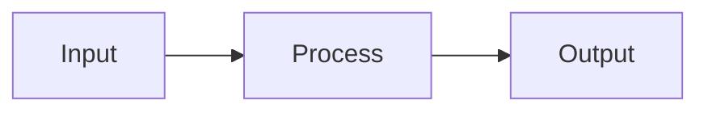

# [Feature/Phase Name]

## Overview
What this feature/phase accomplishes and why it's needed.

## Goals
- Goal 1
- Goal 2

## Architecture

### Components
Describe the main components and their responsibilities.

### Data Flow
Explain how data moves through the system.

## Interface Definitions

### Inputs
- What the feature receives

### Outputs
- What the feature produces

## Error Handling
What error conditions exist and how they should be communicated.

## Risks & Mitigations
| Risk | Mitigation |
|------|------------|
| Risk 1 | How to address it |

## Dependencies
- Links to relevant context files
- External dependencies

## Acceptance Criteria
- [ ] Criterion 1
- [ ] Criterion 2
